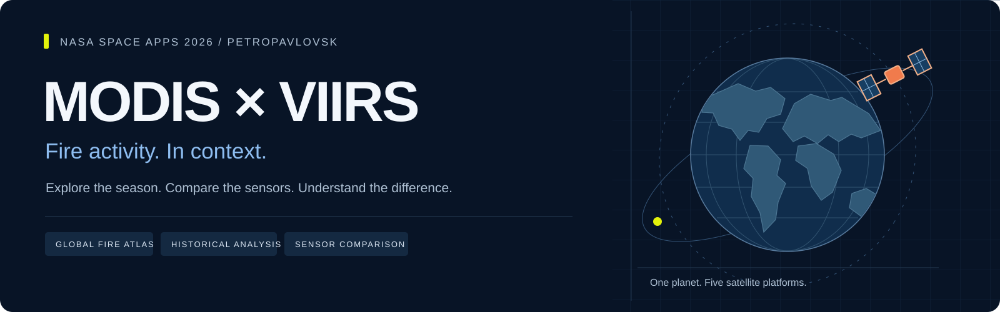
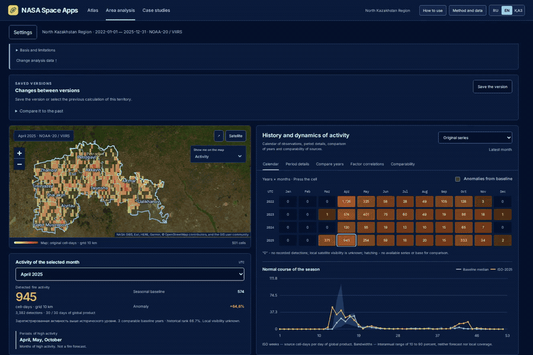
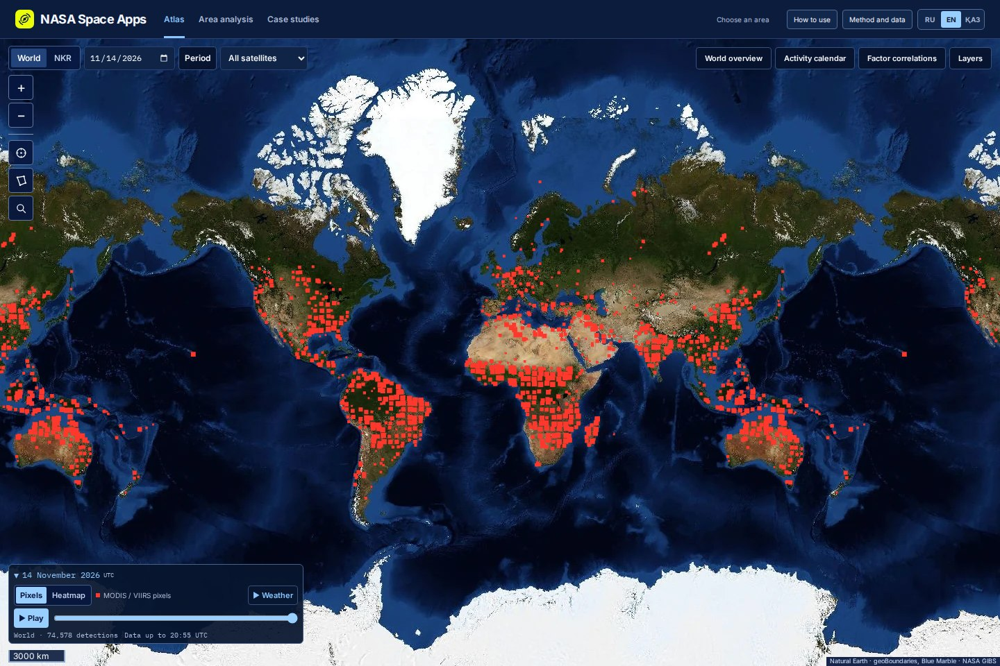
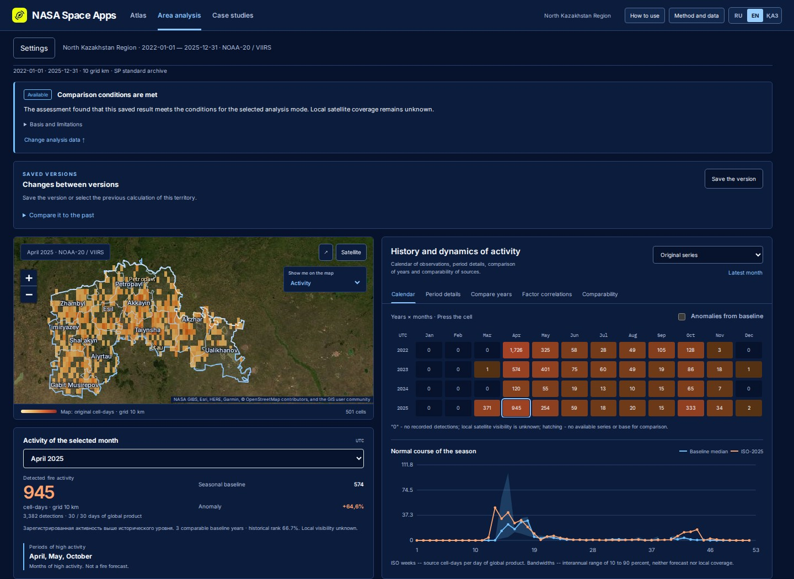
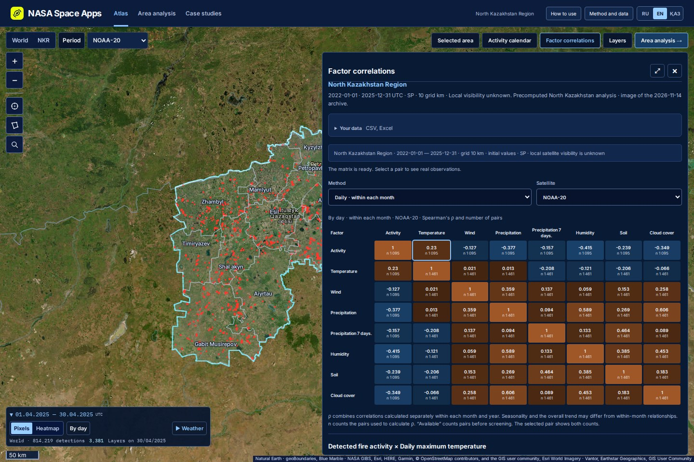
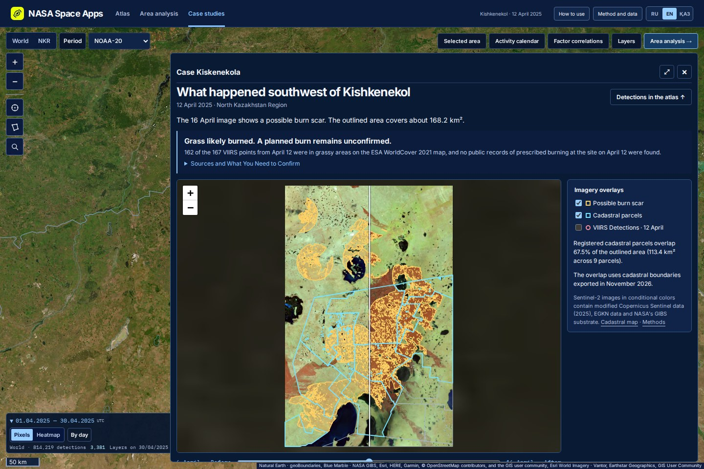
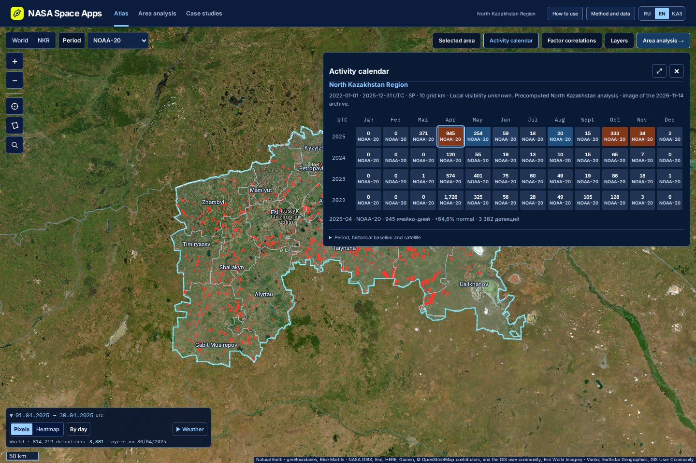
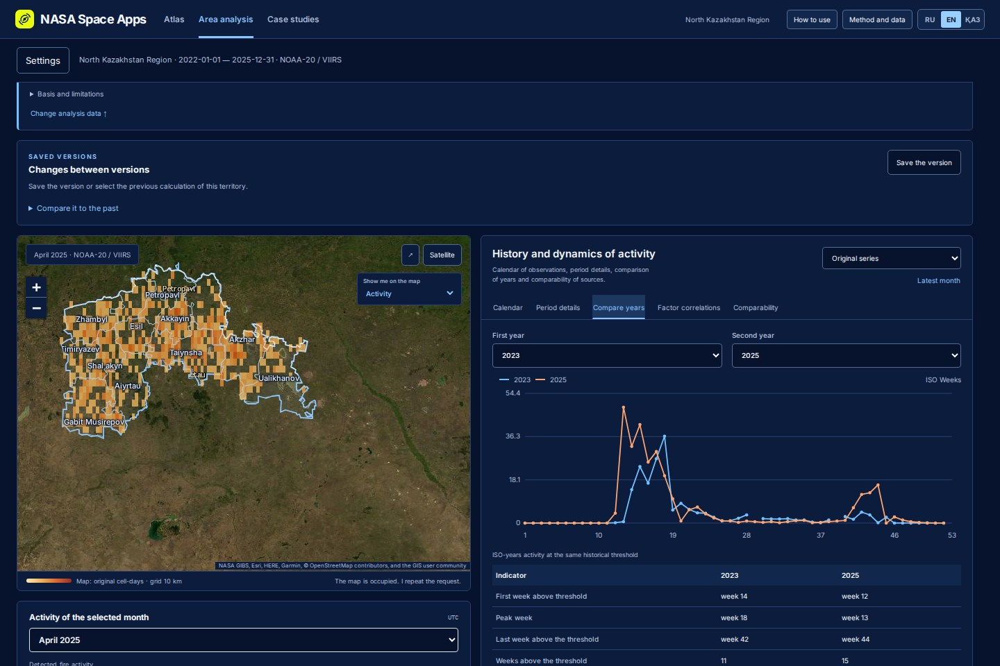
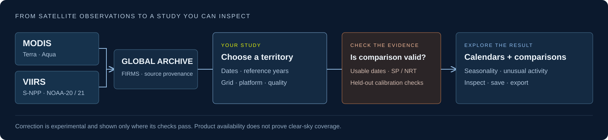

<p align="center">
  
</p>

# Harmonization of MODIS and VIIRS Hot Spots

**When does this area usually burn? What is unusual now? Which periods deserve attention?**

A global web application for exploring fire activity through time, comparing satellite observations and inspecting the evidence behind a result. Built and submitted for the **NASA International Space Apps Challenge 2026 · Petropavlovsk, Kazakhstan**.

<p align="center">
  
</p>
<p align="center">
  <a href="https://nasa.aican.cloud/"><b>Open the application ↗</b></a> &nbsp; · &nbsp;
  <a href="https://nasa.aican.cloud/?view=atlas&amp;demo=sko"><b>Try the prepared example ↗</b></a> &nbsp; · &nbsp;
  <a href="web/README.md">Руководство на русском</a>
</p>
<p align="center">
  <a href="#a-short-tour">Demo</a> · <a href="#inside-the-workspace">Screenshots</a> · <a href="#how-it-works">How it works</a> · <a href="#scientific-scope">Scientific scope</a> · <a href="#development">Run locally</a> · <a href="#complete-historical-database">Data</a>
</p>

> [!TIP]
> **Start with the [prepared North Kazakhstan example](https://nasa.aican.cloud/?view=atlas&demo=sko).** It opens an existing calendar and factor matrix, so you can explore the tools before requesting a new regional calculation.

## A short tour

[](docs/assets/readme/walkthrough.mp4)

**[Watch / download the MP4](docs/assets/readme/walkthrough.mp4)** · A 17-second tour of the live workspace. Navigation waits are cut and playback is slightly accelerated. The charts use existing North Kazakhstan results; the imagery case is Kishkenekol. [Media notes and credits](docs/assets/readme/README.md).

## Inside the workspace

<table>
  <tr>
    <td width="50%" valign="top">
      <a href="docs/assets/readme/world.jpg"></a>
      <p><b>01 · Atlas — choose where to look</b><br>Explore observations worldwide, change the period and platform, then carry a selected territory into analysis.</p>
    </td>
    <td width="50%" valign="top">
      <a href="docs/assets/readme/analysis.jpg"></a>
      <p><b>02 · Analysis — understand the season</b><br>Read the historical calendar, compare years and locate activity that differs from the selected seasonal baseline.</p>
    </td>
  </tr>
  <tr>
    <td width="50%" valign="top">
      <a href="docs/assets/readme/matrix.jpg"></a>
      <p><b>03 · Matrix — explore relationships</b><br>Inspect weather and landscape factors, pair counts and scatter plots. Import your own table. Correlation describes a relationship; it does not establish its cause.</p>
    </td>
    <td width="50%" valign="top">
      <a href="docs/assets/readme/case.jpg"></a>
      <p><b>04 · Cases — inspect the place</b><br>Compare before/after imagery and contextual layers alongside the temporal evidence.</p>
    </td>
  </tr>
</table>

<details>
<summary><b>More screens: atlas calendar and year comparison</b></summary>

**The calendar stays connected to the map.** Select a month to inspect its geography and daily activity.



**Compare seasons on the same time axis.** Inspect when activity rises and peaks across selected years.



</details>

The screenshots show the live application captured on **16 November 2026**, with the periods displayed in each view. They are fixed illustrations, rather than a continuously refreshed data feed. Click a gallery image to open it at full size.

## How it works



The same real fire can produce different observations in MODIS and VIIRS. The instruments differ in resolution, sensitivity and observation time; adding more satellites also changes the number of detections. A shared grid organizes those observations, but does not by itself make them comparable.

The application keeps source observations separate and evaluates an experimental conversion to the **Aqua MODIS scale** where regional checks allow it. The goal is to make seasonal comparisons easier to interpret while keeping the source, conditions and limits visible. [Method, implementation and API](docs/workbench.md) · [Regional validation](docs/sko-validation/README.md).

The repository includes a NASA FIRMS downloader, a global historical archive and the web application. Its scope is **global**. North Kazakhstan Region (Северо-Казахстанская область, СКО) is the prepared demonstration and validation case. California and Mato Grosso also have regional implementation and holdout checks; validation against independent national fire registries remains unfinished. Large datasets live on the shared `unik` server, outside Git.

## Application

[Open the application](https://nasa.aican.cloud/) · [Prepared SKO example](https://nasa.aican.cloud/?view=atlas&demo=sko)

The persistent header connects **Atlas**, **Area Analysis** and **Cases**. The interface supports Russian, English and Kazakh, detects the initial language from the browser and allows switching without reloading. Phone and tablet layouts support touch selection, drawing, scrolling calendars and matrices, and portrait/landscape use. A first-use tour introduces the tools.

The main workflow is:

1. **Choose an area.** Search for a country, region or city, select nested boundaries, or draw a rectangle, polygon or point/radius area. City search resolves an available municipal boundary before offering a radius fallback. The selected geometry is carried into the analysis.
2. **Choose the question and period.** Investigate a seasonal anomaly, compare activity across years, or examine sensor comparability.
3. **Check available data and explicitly select conditions.** The [study planner](docs/study-planner.md) proposes satellites, historical periods and reference years from archive metadata. This preflight does not scan the spatial archive or establish local observation coverage. Manual settings remain available.
4. **Run and inspect the result.** Read the years-by-month calendar, weekly seasonal profile, monthly anomaly map, year comparison and held-out calibration checks. The result assessment explains which comparisons are supported. Export numerical results as CSV/JSON and visualizations as SVG.

Selecting an area alone does not launch a hidden regional calculation. Atlas calendars and factor matrices calculate when their panels are opened. Identical scientific inputs reuse an existing running or completed analysis/matrix job; source versions and filters participate in the cache identity. See the [workbench and API](docs/workbench.md) and the [development goal](docs/development-goal.md).

Additional tools:

- **Factor matrices:** numerical weather and landscape relationships for the selected area using ERA5, WorldCover, GLO-90 and GeoNames, with missing values, pair counts and provenance preserved. [Method and sources](docs/global-matrix.md).
- **Your own factors:** import CSV, XLSX or XLS in the atlas matrix panel, select numeric columns and an optional date column, and compare file-only factors or align them with atlas periods. Files are processed on the device. Limits are 10 MiB, 10,000 data rows, 120 columns and 12 selected factors.
- **Saved research versions:** explicitly pin completed results and compare what changed in conditions, observations, reference periods or methods. Saved numerical snapshots are separate from the disposable computation cache; old map files may still expire. [Retention, comparison and API](docs/revisions.md).
- **Prepared examples:** a world calendar over the available archive, a separate world factor snapshot for 2022–2025, an SKO calendar/matrix for 2022–2025, and the Kishkenekol before/after imagery case. Their dates, grids and provenance are displayed; they are not interchangeable datasets.

Oksana's atlas, layers and case studies are integrated into the application. Existing `/atlas.html` links redirect to the corresponding view and preserve case anchors. Overview markers may combine detections; detailed views request original positions. The number of visible markers is not the number of fires. See the [atlas guide](web/README.md).

Shared-server data paths and the existing Komodo push-to-`main` deployment are documented in [deploy/README.md](deploy/README.md). World archives are downloaded and processed on `unik`, not on the laptop.

## Scientific scope

A hot-spot detection is not an individual fire, and a detection pixel is not burned area. The harmonized indicator is an experimental estimate on the Aqua MODIS scale, available only when the regional held-out checks and the selected period pass the implementation's eligibility rules.

Local overpass/cloud masks are not yet ingested: product availability does not prove a clear-sky observation of the selected area. Independent US/Canada fire-registry validation, full uncertainty estimates and global transfer accuracy remain open. ERA5 cloud cover is contextual data, not a satellite visibility mask; factor correlations are descriptive, not causal explanations or fire forecasts. See the [scientific limits](docs/workbench.md#открытые-научные-ограничения).

## Research

[Global data sources and methodology notes (RU)](docs/global-data/README.md) preserves the team's worldwide source inventory, distinctions between detections/events/burned area, and proposed cross-region validation plan. Unverified source versions and archive availability are marked explicitly.

[Full Russian translation of the challenge and explanatory video](docs/challenge/README.md) includes the team's original DOCX and implementation notes.

[MODIS and VIIRS harmonization research and findings (RU)](docs/modis-viirs-research.md) covers FIRMS data access, the June 2023 Semey Ormany case study, and a proposed validation and MVP plan for North Kazakhstan Region.

[North Kazakhstan validation, 2020–2025 (RU)](docs/sko-validation/README.md) reports out-of-sample errors for two VIIRS platforms, the effect of documented outages, and how to reproduce the results.

## Research roadmap

1. Ingest local observation and cloud masks to distinguish missing observations from observed periods without detections.
2. Validate against independent registered-fire datasets and test transfer to additional regions.
3. Extend uncertainty assessment beyond variation in the calibration coefficient.
4. Keep the demonstration reproducible as data and methods evolve, with explicit validation limits, source attribution and the [generative AI disclosure](DATA_USAGE.md).

## Official resources

<details>
<summary>Challenge, event and participant resources</summary>

- [2026 NASA Space Apps Challenge](https://www.spaceappschallenge.org/2026/)
- [2026 challenges](https://www.spaceappschallenge.org/2026/challenges/)
- [Selected challenge](https://www.spaceappschallenge.org/2026/challenges/modis-and-viirs-hot-spots/)
- [Participant resources](https://www.spaceappschallenge.org/resources/)
- [Participant terms and conditions](https://www.spaceappschallenge.org/legal/)
- [Petropavlovsk event announcement — SKO Hub](https://astanahub.com/ru/event/nasa-space-apps-challenge/)

</details>

## Development

### Application and API

CI uses Python 3.13. For the full analysis dependencies and spatial tests:

```bash
python3 -m venv .venv
source .venv/bin/activate
python -m pip install -r requirements-analysis.txt
python -c "import duckdb; c=duckdb.connect(); c.execute('INSTALL spatial'); c.execute('LOAD spatial')"
python -m unittest discover -s tests -v
```

`requirements-global.txt` contains the core DuckDB dependency; `requirements-analysis.txt` also installs NumPy and Rasterio for the analysis service. For a static interface preview:

```bash
python -m http.server 8000 --bind 127.0.0.1 --directory web
```

Open <http://127.0.0.1:8000/>. This previews the interface and bundled examples; live maps, archive checks, new regional analyses and saved versions need the backend on the same origin. See the [local API instructions](docs/workbench.md#запуск-и-данные) and [server deployment](deploy/README.md). Existing shared-server data does not require each teammate to download the archive or provide a FIRMS key to the browser.

### FIRMS downloader

<details>
<summary>Download a small area yourself — Python 3.10+, no external packages</summary>

The standalone downloader requires Python 3.10 or newer and no external packages.

1. Obtain a free [FIRMS MAP_KEY](https://firms.modaps.eosdis.nasa.gov/api/map_key/).
2. Copy `.env.example` to `.env` and fill in `FIRMS_MAP_KEY`. An environment variable with the same name takes precedence.
3. Run a download for North Kazakhstan Region:

```bash
python3 scripts/fetch_firms.py \
  --region sko \
  --start 2024-07-01 \
  --end 2024-07-10 \
  --sources MODIS_SP VIIRS_SNPP_SP
```

Dates are inclusive. The script splits the period into requests of at most five days, then writes one CSV per source into `data/raw/firms/sko/`. It queries the polygon's bounding box and keeps observations whose centre coordinates fall inside or on the boundary of the region. Original NASA columns and values are preserved. The output is input for future harmonization; the downloader does not harmonize sensors.

The region boundary comes from geoBoundaries, with reference year **2017**; it has not been verified against the current official boundary. See [boundary provenance and ODbL attribution](data/boundaries/README.md).

For another rectangle, use `--bbox west,south,east,north` instead of `--region sko`, for example `--bbox 68,54,71,56`. These unfiltered exports are saved directly into `data/raw/firms/`. A custom `--output-dir` overrides either default directory.

For recent observations, select sources such as `MODIS_NRT VIIRS_NOAA20_NRT` and use dates covered by those feeds. Check [current product availability](https://firms.modaps.eosdis.nasa.gov/api/data_availability/) before choosing dates. For large historical exports, use the FIRMS archive download service.

</details>

### Verification

Unit and integration tests cover downloads, geometry, temporal comparisons, study planning, saved revisions, and analysis/matrix cache reuse. DuckDB's `spatial` extension is required for the spatial checks; live FIRMS downloads require a valid MAP_KEY.

Optional browser checks require Playwright and Chromium. The study-planner and cache-reuse harnesses use local synthetic API fixtures; they test behavior rather than scientific accuracy:

```bash
python -m pip install playwright
python -m playwright install chromium
python tests/e2e_study_planner.py
python tests/e2e_result_reuse.py
python tests/e2e_language.py --local-web
python tests/e2e_matrix_file.py --local-web
```

The separate live workbench check is `python tests/e2e_workbench.py --base-url URL`; it uses the supplied analysis service. CI runs the Python suite, checks Compose configurations, and builds/scans the application images.

[Agent workflow](docs/agent-workflow.md) records the coordinator → UI worker hierarchy and independent review gates; [feature acceptance](docs/workbench-features.json) records verified capabilities and unfinished data integrations.

## GitHub monitoring

<details>
<summary>How the shared development checkout follows GitHub</summary>

`scripts/watch_github.py` performs a read-only snapshot of this repository's branches, tags, issues, pull requests, reviews, comments, releases, workflow runs, recent events, and selected repository settings. It compares snapshots and records changes in `data/monitor/github/changes.jsonl`. The first run establishes a baseline. Failed checks preserve the last successful baseline.

```bash
python3 scripts/watch_github.py --sync
systemctl --user status nasa-space-apps-github-monitor.timer
systemctl --user stop nasa-space-apps-github-monitor.timer
```

The user systemd timer in `ops/` checks every **20 seconds** and starts again at login when enabled. With `--sync`, it fetches origin, records changed file paths, saves documentation/research diffs in `data/monitor/github/latest-research.md`, and fast-forwards the current branch when Git can preserve local edits. Conflicting local edits or diverged branches are reported for manual integration; it never resets, discards edits, or pushes. The installed service sends **no desktop notifications**. During active development, the agent reads these local updates to incorporate teammates' research; the service itself does not run an AI agent or update conversation context. This polling monitor is not a complete GitHub audit log: activity created and removed between polls may be missed, and GitHub's recent-event feed has retention limits.

</details>

## Complete historical database

### Global archive

The shared archive contains Terra/Aqua MODIS and Suomi-NPP, NOAA-20 and NOAA-21 VIIRS over their available dates, beginning in 2000. Annual observations are combined with a deduplicated live tail; availability differs by platform. The [live catalog](https://nasa.aican.cloud/datasets/catalog.json) and [manifest](https://nasa.aican.cloud/datasets/manifest.json) describe actual coverage, checksums and freshness.

For a fixed downloadable snapshot, use the [global data release](https://github.com/MaximushkaBed/nasa-space-apps-petropavlovsk/releases/tag/data-global-2026-11-14). Individual assets can be downloaded by year; `release-manifest.json` and `SHA256SUMS` describe their paths and checksums. This fixed release and the continuously updated server archive have separate lifecycles. [Archive guide](data/global/README.md).

### Reproduce the SKO history

<details>
<summary>Build the regional archive and an offline historical report</summary>

```bash
python3 -u -m scripts.build_history --region sko --start 2000-11-01
python3 -m scripts.render_history
```

The default end date is today in UTC. The history builder includes MODIS (Terra and Aqua) and VIIRS (Suomi-NPP, NOAA-20, NOAA-21) over their available date ranges. It downloads published annual Kazakhstan CSVs for the standard archive and clips them to the region. Missing annual files and the recent tail are fetched through the Area API. SP takes precedence over NRT for each sensor so their date ranges do not overlap. All original columns, processing status, satellite, and collection versions are retained.

Each completed part is cached with a SHA-256 checksum in `data/cache/firms-history/sko/`. Rerun the command after an interruption to resume. Recent NRT parts are refreshed; `--refresh` reloads all parts. The manifest is marked complete only after every planned part succeeds.

Local outputs in `data/raw/firms/sko/history/`:

- `observations.csv`: the full clipped observation database with source/processing/platform metadata.
- `monthly.csv` and `yearly.csv`: separate sensor summaries, including zero detections in successfully queried periods and flags for partial periods.
- `summary.json`: aggregates, source availability, collection-version counts, and interpretation notes.
- `manifest.json`: retrieval coverage, checksums, source URLs for public archive files, and completion status. API keys are excluded.

The renderer exports an offline interactive calendar and annual chart to `reports/sko-history.html`, with aggregate JSON and CSV exports alongside it. Add `--plot` to also export `reports/sko-history.png` (requires matplotlib). These are **raw observation summaries**, not a harmonized fire-count or burned-area estimate. Product availability and successful queries do not establish clear-sky satellite coverage; a zero count is not proof that no fire occurred.

</details>

### Share the database

The [data snapshot release](https://github.com/MaximushkaBed/nasa-space-apps-petropavlovsk/releases/tag/data-sko-2026-11-14) contains the full observation database and offline report as a ZIP attachment, with a SHA-256 checksum. Download the attachment to use the prepared data without an API key. Choose the named `sko-history-...zip` asset; GitHub's automatic “Source code” ZIP contains repository code and aggregates only.

To rebuild the data package after downloading and rendering the history:

```bash
python3 -m scripts.package_history
```

## Open data

See [Data Usage](DATA_USAGE.md) for the project's generative AI disclosure.

- [NASA FIRMS archive downloads](https://firms.modaps.eosdis.nasa.gov/download/): hotspot observations in CSV, JSON, and Shapefile formats. Archive access requires Earthdata Login or email authentication.
- [FIRMS API](https://firms.modaps.eosdis.nasa.gov/api/): request hotspot observations by area, date, and sensor.
- [FIRMS API key](https://firms.modaps.eosdis.nasa.gov/api/map_key/): obtain a MAP_KEY for API access.

Keep API keys in a local `.env` file. Credentials and raw data downloads must not be committed.

## The project

Built by **Maxim and Oksana** for NASA Space Apps in Petropavlovsk. Challenge: **Harmonization of MODIS and VIIRS Hot Spots**; the team's local challenge label is `15 - Harmonization of MODIS and VIIRS Hot Spots_4.3`.

The hackathon project has been submitted. This repository keeps the application, research notes and reproducibility instructions together. [Data attribution and AI disclosure](DATA_USAGE.md) · [Media credits](docs/assets/readme/README.md).

<p align="center">
  <br>
  <sub>POV: the last CSV finally parses.<br>GIF: <a href="https://tenor.com/view/anime-typing-on-computer-smiling-online-gif-11961164">Kenghui / Tenor</a></sub>
</p>
