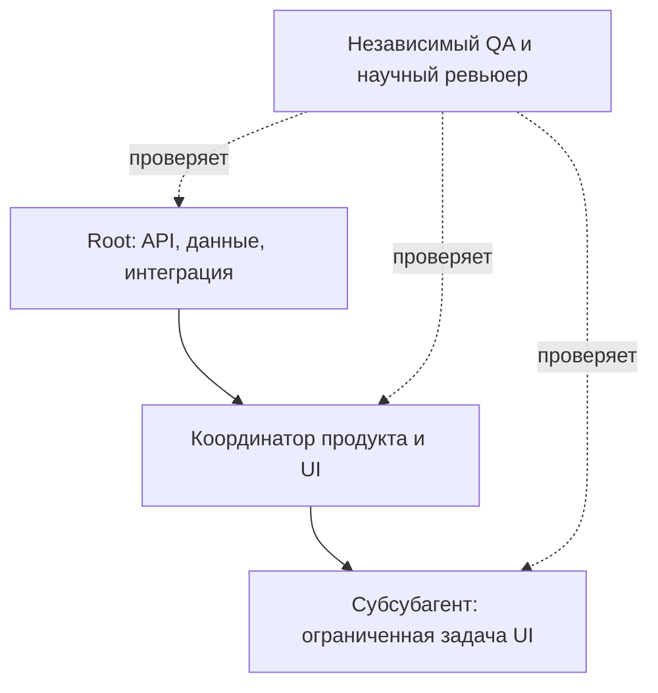

# Разработка NASA Space Apps несколькими агентами

Правила основаны на первичных источниках, проверенных 14 ноября 2026 года.
Это выбранная для нашего проекта схема, а не обещание гарантированного качества
или утверждение, что любое количество агентов улучшает разработку.

## Действующая топология

Одновременно доступны четыре слота, включая главного агента:

Root сохраняет пользовательский контекст, контракты API и ответственность за
развёртывание. Координатор декомпозирует продуктовые требования и сам создаёт
одного исполнителя. После завершения этой задачи слот можно последовательно
передать браузерному тестировщику. Ревьюер не подчиняется исполнителю и не
редактирует проверяемую реализацию; он также продолжает читать новые коммиты.

Схема manager/specialists сохраняет одного ответственного за итог и подходит
для ограниченных подзадач. Исследовательская система Anthropic показывает,
что существенная часть пользы и сложности находится в декомпозиции и
координации. Это перенос архитектурного принципа на наш проект, не перенос
чужих оценок качества на NASA Space Apps.

Источники: [OpenAI Agent orchestration](https://openai.github.io/openai-agents-python/multi_agent/),
[Anthropic multi-agent research system](https://www.anthropic.com/engineering/multi-agent-research-system).

## Контракт каждой задачи

До запуска исполнитель получает цель, связанные требования из
`workbench-features.json`, разрешённые файлы, входной/выходной контракт,
проверки и условие остановки. Результат содержит список файлов, выполненные
команды, результаты и оставшиеся ограничения. Роль не заменяет проверку.

- Root владеет `api/`, серверными тестами, `deploy/`, интеграцией и документацией.
- UI-команда владеет `web/index.html`, `web/workbench.js`, `web/workbench.css`.
- Изменения Оксаны сохраняются. Её атлас и исследования доступны отдельно через
  `web/atlas.html`; действующие контракты изучаются перед объединением.
- Ревьюер пишет доказательства и решения в игнорируемый
  `data/monitor/github/quality-review.md`, а не исправляет код незаметно.
- Коммит, merge и deploy выполняет root после проверок. Force push и удаление
  чужой работы не используются.

Разделение независимых файлов уменьшает конфликты. Последовательные этапы
«контракт → реализация → интеграция → проверка» не распараллеливаются ради числа
агентов. Ограниченная глубина в два перехода сохраняет контекст и свободные
ресурсы. Это наш вывод из
[Google Research о масштабировании агентных систем](https://research.google/blog/towards-a-science-of-scaling-agent-systems-when-and-why-agent-systems-work/),
а не универсальная оптимальная конфигурация.

## Приёмка и обратная связь

Путь задачи: `planned → implementing → review → verified`.
Ревьюер выносит PASS, REVISE или BLOCK и указывает воспроизводимое основание.
Самооценка исполнителя не переводит функцию в verified.

PASS требует соответствия пользовательскому сценарию, корректной единицы и
происхождения данных, проверок расчётов, реального браузерного прогона для UI,
сохранения чужой работы и отсутствия незакрытых критических замечаний.
Успешному исполнителю можно передать следующий участок и сохранить удачный
подход. REVISE возвращает конкретную ошибку с примером и ожидаемым результатом.
BLOCK запрещает заявлять готовность и публиковать затронутую функцию.
Если исполнитель повторяет подтверждённую критическую ошибку или нарушает
границы задачи после обратной связи, координатор останавливает его и передаёт
сохранённую задачу другому агенту. Это управление работой, а не система
вознаграждения модели или возможность изменять её обучение.

Ключевые проверки NASA Space Apps: одинаковые части периода; отсутствие продукта
отдельно от отсутствия детекций; недельная сезонность; выбранная территория;
train/test без утечки; сравнение с исходным и сезонным методом; uncertainty;
ручное сравнение лет; карта отклонений; CSV/изображение; три реальные территории.
Маски локального покрытия и независимые реестры не объявляются подключёнными,
пока они действительно не получены и не проверены.

[Anthropic о long-running harnesses](https://www.anthropic.com/engineering/effective-harnesses-for-long-running-agents)
поддерживает использование сохраняемого списка функций, истории изменений и
проверки отдельных пользовательских сценариев. У нас такие артефакты дополняют
живые задания агентам и сохраняют прогресс между контекстами.
