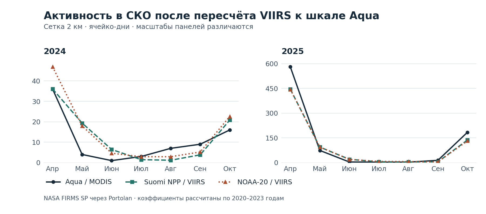

# Проверка гармонизации MODIS и VIIRS в Северо-Казахстанской области

На шести сезонах NASA FIRMS проверили, насколько хорошо показатели VIIRS можно пересчитать в шкалу **Aqua/MODIS**. Коэффициенты подобраны по 2020–2023 годам. На отложенных 2024–2025 годах средняя абсолютная ошибка месячных значений на сетке 2 км снизилась примерно на **85%** у обеих платформ VIIRS. Годовое смещение меняло знак, поэтому пересчитанный ряд подходит для экспериментального календаря СКО с указанием источника и ограничений наблюдения.



## Данные и метод

1. **Выборка.** Aqua/MODIS, Suomi NPP/VIIRS и NOAA-20/VIIRS, апрель–октябрь 2020–2025 годов. Оставили стандартные записи FIRMS (`quality=sp`), центры внутри [полигона СКО](../../data/boundaries/README.md), предполагаемое горение растительности (`type=0`) и номинальную или высокую уверенность (MODIS ≥30, VIIRS `n/h`). После всех фильтров осталось **63 073 детекции**. У Aqua архив маркирует сезоны 2020–2022 `6.03`, а 2023–2025 — `61.03`. Обе версии входят в оценку. NOAA-21 и Terra в этот эксперимент не входят. [Архив FIRMS](https://firms.modaps.eosdis.nasa.gov/download/) · [Portolan и происхождение данных](https://source.coop/portolan-mirrors/firms-catalog) · [Руководство MODIS](https://www.earthdata.nasa.gov/s3fs-public/2023-09/MODIS_C6_C6.1_Fire_User_Guide_1.0.pdf)
2. **Покрытие.** Из сравнения всех трёх платформ исключили [71 дату UTC с известными пропусками](outages.csv). В список вошли даты из таблицы FIRMS SP, период ограниченного покрытия Aqua в августе 2020 года и 17 апреля 2022 года, когда NASA сообщала о возобновлении съёмки с оговорками по качеству. Осталось 1 213 календарных дней, из них 412 в тесте. Для остальных дней качество локального наблюдения по облачности и геометрии пролёта неизвестно. [Пропуски FIRMS](https://firms.modaps.eosdis.nasa.gov/api/missing_data/) · [Сбой Aqua в апреле 2022 года](https://ladsweb.modaps.eosdis.nasa.gov/alerts-and-issues/200056)
3. **Единица измерения.** Проекция EPSG:6933, фиксированная сетка 2 × 2 км. Для каждого спутника каждая ячейка учитывается один раз в сутки UTC при наличии хотя бы одной детекции. Месячное значение — сумма таких суточных счётчиков в ячейко-днях. Платформы VIIRS оценивали по отдельности. Дополнительно проверили сетки 1 и 5 км, дневные и ночные детекции и неперекрывающиеся семидневные окна от 1 апреля, включая остаток сезона.
4. **Калибровка.** Коэффициент каждой платформы равен сумме ячейко-дней Aqua за 2020–2023 годы, делённой на сумму ячейко-дней этой платформы VIIRS на тех же датах. Коэффициент умножается на месячные и недельные значения VIIRS. Контроль — Aqua за те же даты в 2024–2025 годах. MAE — среднее абсолютное отклонение от Aqua, смещение — разница сумм в процентах от суммы Aqua.

Отдельная сверка копии Portolan с исходными `MCD14ML.202404.061.03.txt.gz` и `MCD14ML.202504.061.03.txt.gz` Университета Мэриленда подтвердила все отфильтрованные точки Aqua в СКО по дате, минуте и координатам. Совпали **44 из 44** за апрель 2024-го и **688 из 688** за апрель 2025-го. [Доступ к MCD14ML, раздел 4.3 руководства](https://www.earthdata.nasa.gov/s3fs-public/2023-09/MODIS_C6_C6.1_Fire_User_Guide_1.0.pdf)

## Результаты на отложенных сезонах

**Сетка 2 км, все наблюдения, 14 месяцев и 62 недельных окна.**

| Платформа VIIRS | Коэффициент | MAE в месяц, до → после | MAE за неделю, до → после | Смещение суммы, до → после |
| --- | ---: | ---: | ---: | ---: |
| Suomi NPP | 0,2932 | 128,36 → **19,24** | 29,27 → **5,13** | +190,7% → **−14,8%** |
| NOAA-20 | 0,2897 | 133,29 → **20,34** | 30,32 → **5,31** | +198,7% → **−13,5%** |

До перехода на сетку в тестовом периоде VIIRS регистрировал примерно **в 5,1 раза больше точек**, чем Aqua. У подсчёта ячейко-дней на сетке 2 км без поправки осталось примерно **2,9–3,0 раза**. Ещё один ориентир — прогноз на основе исторической медианы Aqua для того же месяца, с пересчётом по числу включённых дней. Его MAE составила **74,54** ячейко-дня за месяц.

| Тестовый сезон | Aqua | Suomi NPP после поправки | NOAA-20 после поправки | Смещение Suomi / NOAA-20 |
| --- | ---: | ---: | ---: | ---: |
| 2024 | 76 | 89,1 | 103,1 | +17,3% / +35,7% |
| 2025 | 863 | 711,3 | 709,4 | −17,6% / −17,8% |

Пик обоих тестовых сезонов пришёлся на апрель у всех трёх платформ. В каждом сезоне четыре из пяти недель с наибольшей активностью по Aqua попали в пятёрку у обеих платформ VIIRS. Постоянный множитель сохраняет порядок недель внутри ряда VIIRS, поэтому это совпадение отражает сезонный рисунок в исходных наблюдениях.

### Чувствительность и совпадение на карте

| Сетка и режим | Месячная MAE Suomi, до → после | Месячная MAE NOAA-20, до → после |
| --- | ---: | ---: |
| 1 км, все наблюдения | 181,79 → 19,17 | 188,21 → 19,80 |
| 2 км, все наблюдения | 128,36 → 19,24 | 133,29 → 20,34 |
| 5 км, все наблюдения | 94,93 → 16,59 | 102,64 → 16,86 |
| 2 км, только день | 113,14 → 16,54 | 118,57 → 18,03 |

На каждой сетке пересчёт уменьшает ошибку относительно Aqua. Показатели между сетками измеряются в ячейках разной площади, поэтому по меньшей абсолютной MAE нельзя выбрать пространственное разрешение. Если исключить весь 2022 год при подборе коэффициентов, месячная MAE сетки 2 км меняется с 19,24 до 19,23 у Suomi и с 20,34 до 20,40 у NOAA-20. Дневная оценка показывает меньшее остаточное смещение (−7,3% и −4,9%). В выборке Aqua за 2024–2025 годы отсутствуют подходящие ночные точки, поэтому оценка точности ночного пересчёта по этому сравнению невозможна.

Совпадение отдельных ячеек ограничено. В тесте Aqua и Suomi отметили в те же сутки **368** общих ячейко-дней из **3 301** в объединении (11,1%). Для NOAA-20 — **356 из 3 388** (10,5%). В одной ячейке и сутках с одинаковым признаком дня или ночи и разницей времени до 60 минут совпали 261 ячейко-день с Suomi и 264 с NOAA-20. Это совпадения среди уже обнаруженных точек. Оценка вероятности обнаружения требует масок покрытия и облачности Level 2. [Руководство VIIRS Collection 2](https://www.earthdata.nasa.gov/s3fs-public/2025-06/VIIRS_C2_AF-375m_User_Guide_1.2.pdf)

## Что использовать в календаре

- Для сезонного прототипа СКО показывать месячный показатель на сетке 2 км и подписывать пересчитанные значения **«в шкале Aqua»**. Отдельно отображать исходные детекции VIIRS и платформу для каждого периода.
- Показывать число включённых и исключённых дней, источник и режим SP/NRT. При сравнении с исторической нормой применять одинаковое определение показателя и явно отмечать различия в покрытии.
- Использовать найденные коэффициенты только как исходные оценки для этого полигона и этих платформ. Для NOAA-21, раннего MODIS/Terra, других регионов и ночного режима нужны отдельные проверки. Остаточная ошибка по годам и слабое совпадение отдельных ячеек ограничивают интерпретацию на карте и использование в оперативной оценке.

## Воспроизведение

Запустите команды из корня репозитория. Нужен Python 3.11+ с доступом к каталогу Source Cooperative и расширениям DuckDB.

```bash
python -m pip install "duckdb==2.0.0" "pyproj==3.7.2" "matplotlib==3.10.9"
python scripts/validate_sko_harmonization.py --plot
```

Первый запуск вырезает область из шести годовых GeoParquet-разделов. Локальный кэш в `data/cache/sko-validation/` позволяет повторить расчёт офлайн. Без `--plot` достаточно DuckDB и pyproj. [Месячные значения](monthly.csv) содержат 42 строки. [Метрики и контрольные суммы](metrics.json) включают чувствительность к сетке, результаты по сезонам, версии исходных записей и SHA-256 локальных выборок. [Список исключённых периодов](outages.csv) фиксирует даты и источники для повторного прогона.

Данные предоставлены NASA FIRMS в рамках NASA LANCE и ESDIS. Копия архива получена через Portolan на Source Cooperative. [NASA FIRMS](https://earthdata.nasa.gov/firms) · [Portolan](https://source.coop/portolan-mirrors/firms-catalog) · [Дисклеймер NASA](https://www.earthdata.nasa.gov/data/projects/lance/disclaimer)
