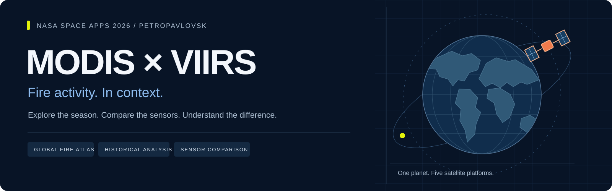
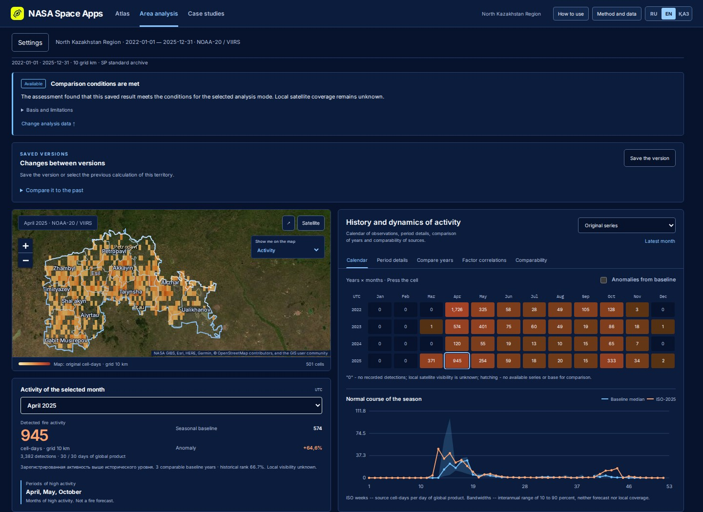

# Атлас и анализ пожарной активности

<p align="center">
  <a href="https://nasa.aican.cloud/"></a>
</p>

**Выбрать территорию → изучить сезон → найти отклонение → проверить данные → сохранить результат.**

[Открыть приложение](https://nasa.aican.cloud/) · [Готовый пример СКО](https://nasa.aican.cloud/?view=atlas&demo=sko) · [Галерея и анимация сценария](../README.md#a-short-tour) · [Короткое видео MP4](../docs/assets/readme/walkthrough.mp4)



> [!TIP]
> **Что для чего:** атлас помогает выбрать место, календарь — увидеть сезонность, анализ — сравнить период с историей, матрица — изучить связи факторов, кейсы — рассмотреть снимки до и после. Ниже — подробное руководство и ограничения каждого инструмента.

Приложение на [nasa.aican.cloud](https://nasa.aican.cloud/) объединяет «Атлас», «Анализ территории» и «Кейсы» под постоянной шапкой. `/atlas.html` остаётся совместимым входом в атлас. Переходы сохраняют выбранную территорию и исследовательские параметры; ссылка или сохранённое состояние браузера могут восстановить ранее выбранный период. [Методика и API](../docs/workbench.md).

Атлас показывает мировые тепловые детекции NASA FIRMS. Дата, спутник и отображение пикселями или тепловой картой меняются независимо. Календарь и численная матрица доступны для выбранных территорий по всему миру. Фиксированное исследование СКО за апрель–октябрь 2020–2025 годов сохранено отдельно; его коэффициенты не подставляются для других регионов. [Проверка этого исследования](../docs/sko-validation/README.md).

Карта занимает рабочую область. Панели слоёв, календаря, связей и выбранной территории можно открывать и сворачивать поверх неё. Подложка и детекции повторяются через меридиан ±180°, а минимальный масштаб подстраивается под высоту окна. Готовый пример СКО доступен по ссылке [«Атлас · СКО»](https://nasa.aican.cloud/?view=atlas&demo=sko): календарь и матрица используют 2022–2025 годы, базу 2022–2024, SP и сетку 10 км. Это отдельный снимок с указанной датой архива. Готовая мировая матрица использует свой период 2022–2025 и сетку 250 км; мировой календарь охватывает весь доступный архив с 2000 года.

## Выбор территории

Кнопки под масштабированием выделяют окружность вокруг точки с радиусом от 0,1 до 1000 км, пользовательский полигон или административную единицу. После выделения панель показывает площадь и разбивку тепловых детекций по спутникам за выбранную дату UTC с учётом активного фильтра. Сводку можно свернуть и открыть значком документа. В поиске «район, страна» районы других стран загружаются из geoBoundaries gbOpen ADM2 при наличии набора. Поиск населённых пунктов использует GeoNames через Open-Meteo. При выборе места атлас ищет в [Overture Maps](https://docs.overturemaps.org/guides/divisions/) границу того же города по стране, названию и координатам. Если границы нет в источнике, выделяется круг. При ошибке источника поиск предлагает повторить запрос. Данные Overture Maps содержат данные [© OpenStreetMap contributors](https://www.openstreetmap.org/copyright) по ODbL. Для Лос-Анджелеса используется [официальная граница города](https://catalog.data.gov/dataset/city-boundary-of-los-angeles). Страны и регионы используют упрощённые границы Natural Earth. Границы районов Казахстана относятся к 2019 году, упрощены из данных Комитета по статистике Министерства национальной экономики Республики Казахстан и HDX. [Natural Earth](https://www.naturalearthdata.com/) · [geoBoundaries gbOpen](https://www.geoboundaries.org/api.html) · [Районы Казахстана и лицензия CC BY 3.0 IGO](https://www.geoboundaries.org/api/current/gbHumanitarian/KAZ/ADM2/) · [Геокодирование GeoNames через Open-Meteo](https://open-meteo.com/en/docs/geocoding-api)

Индекс стран, регионов и районов Казахстана обновляется командой `python scripts/export_atlas_boundaries.py countries.geojson regions.geojson kazakh_districts.geojson` из корня репозитория. В качестве входных данных используются Natural Earth 1:10m ADM0 Countries и ADM1 States and Provinces, а также упрощённый GeoJSON по ссылке `simplifiedGeometryGeoJSON` из записи ADM2 Казахстана. Для экспорта нужен Shapely.

Страну и вложенные административные границы можно выбирать последовательно. Собственный прямоугольник, круг или полигон внутри выбранной родительской территории ограничивается её границей; исходная геометрия сохраняется для расчёта. Панель выбранной области и редактор радиуса предлагают переход в анализ. Выделение само по себе не запускает скрытый региональный расчёт: календарь и матрица рассчитываются при открытии соответствующих панелей. [Точная геометрия и уточнение территории](../docs/study-planner.md#уточнение-территории).

## Карта и периоды

В меню «Период» можно выбрать день, календарную неделю, месяц, год, произвольный диапазон или весь доступный архив. В режиме «По дням» шкала и воспроизведение работают внутри диапазона. Сводка за год и один день содержат разное количество наблюдений; текущий период подписан на шкале UTC. Погодные и прочие датированные слои в сводке показываются на дату окончания периода.

В режиме «Пиксели» обзорные маркеры дня и длинных периодов показаны квадратами. На общем масштабе близкие сигналы объединяются, а для длинного периода используются также пространственные агрегаты. Такие маркеры имеют приблизительное положение и не являются отдельными спутниковыми пикселями. По нажатию показано количество обнаружений в группе. Число маркеров на экране не равно числу детекций или пожаров.

При приближении карта запрашивает исходные координаты для видимой области. В подробном режиме квадраты имеют номинальные размеры MODIS — 1 км и VIIRS — 375 м, с небольшим экранным минимумом для видимости. Если детали ещё не готовы, на карте может сохраняться подписанный сводный обзор. Превышение лимита или ошибка сопровождаются временным уведомлением с предложением приблизить карту, сократить период или повторить запрос. Тепловая карта показывает относительную плотность на текущем масштабе.

Для периодов длиннее 31 дня глобальная сводка построена по агрегатам Portolan: сначала используется более подробный архив r8, а отсутствующие даты дополняются r5. Координаты при приближении берутся из исходных записей без фильтра качества. Для коротких периодов действует фильтр детекций; состав выборки и точность счётчиков различаются и подписаны в интерфейсе.

## Анализ и матрицы

В «Анализе территории» четыре сворачиваемых шага: «Территория», «Задача и период», «Данные для анализа», «Результат». Можно изучать отклонение от сезонной нормы, сравнение активности по годам или сопоставимость спутников. «Проверить доступные данные» предлагает спутник, историю и базовые годы по сведениям архива; пользователь явно выбирает вариант либо ручные настройки до запуска. Это проверка глобального наличия продукта, а не локальной видимости. После расчёта пригодность сравнения оценивается по фактическому результату. [Полный сценарий и ограничения](../docs/study-planner.md).

Результат включает календарь «годы × месяцы», недельную сезонную кривую, детали по дням, месячные отклонения, сравнение лет и проверку гармонизации. CSV/JSON сохраняют численные данные и происхождение; SVG выгружает визуализацию. Повторные запросы с теми же научными параметрами и источниками переиспользуют готовую либо текущую задачу анализа и матрицы. Перемещение между панелями не требует повторного расчёта.

«Связи факторов» использует численные погоду, рельеф, землепокров и расстояние до населённых пунктов для той же области и снимка данных. Пропуски остаются пропусками; для каждого коэффициента показаны число пар и ограничения. Эти связи описательные, а не доказательство причины пожара. [Методика глобальной матрицы](../docs/global-matrix.md).

В панели матрицы можно импортировать CSV, XLSX или XLS: файл читается на устройстве, первая строка содержит заголовки. Выберите лист, до 12 численных факторов и при необходимости столбец дат. Можно рассчитать матрицу только своих факторов либо сопоставить их с активностью атласа по дням или месяцам. Лимиты: 10 MiB, 10 000 строк данных и 120 столбцов. Пустые и некорректные значения не превращаются в нули.

Готовый анализ можно явно сохранить как версию исследования и сравнить с предыдущим через «Что изменилось?». Численные снимки закрепляются на сервере отдельно от временного кэша, на устройстве хранится их список. Параметры, источники и методы сравниваются отдельно от самих значений. Сохранение чисел не гарантирует вечное наличие пространственных файлов старой карты. [Сохранение и сравнение версий](../docs/revisions.md).

## Языки и работа с телефона

Русский, английский и казахский выбираются в общей шапке без перезагрузки. При первом входе учитывается язык браузера; выбор сохраняется. Вводный тур и справка объясняют инструменты. На телефоне дата и спутник открываются компактной кнопкой; панели, календари и матрицы прокручиваются внутри рабочей области. Рисование и завершение полигона доступны касанием, а поворот экрана сохраняет текущую работу.

## Запуск

Из корня репозитория:

```bash
python -m http.server 8000 --bind 127.0.0.1 --directory web
```

Откройте <http://127.0.0.1:8000/>. Статический сервер нужен для чтения JSON веб-приложением. Обзорный Blue Marble и встроенные снимки данных доступны из репозитория; внешние подложки и слои загружаются из своих источников. Сборщик и API-ключ для просмотра не нужны.

Живые детекции, проверка архива, новые региональные расчёты и сохранение версий требуют API с доступом к Parquet на том же origin. Статический сервер сам их не выполняет; встроенные мировые и СКО-примеры позволяют просмотреть готовые данные. [Настройка и маршруты API](../deploy/README.md).

## Источники и пересчёт

Коэффициенты, база 2020–2023 и сетка 2 км ниже относятся к фиксированному исследованию СКО. Для текущего глобального анализа действуют выбранные параметры и [правила временной методики](../docs/workbench.md), а допуск коррекции проверяется отдельно для области и платформы. Локальные маски пригодных наблюдений и облачности пока не подключены; независимая проверка по ведомственным реестрам пожаров и полная неопределённость остаются открытыми задачами. Облачность ERA5 не заменяет маску спутниковой видимости.

- В едином ряду фиксированного исследования СКО в сезонах 2020–2023 используется Aqua/MODIS, в сезонах 2024–2025 — NOAA-20/VIIRS с месячным коэффициентом 0,2897. Источник закреплён за месяцем и указан в календаре, на карте и рядом с выводом. Даты перехода выбраны по границе калибровочной и проверочной выборок, а суммы считаются по одному источнику на месяц. Можно открыть отдельный спутник для сравнения.
- В подробном режиме карта показывает исходные координаты детекций MODIS и VIIRS из зеркала FIRMS. В режиме «Пиксели» близкие суточные сигналы на обзорном масштабе объединяются. С масштаба 7 при готовом ответе сервера показываются отдельные квадраты по координатам детекций. Сторона соответствует номинальному размеру пикселя, 1 км для MODIS и 375 м для VIIRS, с небольшим экранным минимумом для видимости. Тепловая карта передаёт относительную плотность на текущем масштабе. Календарь СКО считает ячейко-дни на сетке 2 × 2 км и может открыть на карте день с максимальным числом таких ячеек за выбранный месяц. [Как FIRMS отображает пиксели](https://wiki.earthdata.nasa.gov/spaces/FIRMS/blog/2022/07/24/259818054/How%2Bto%2Bcustomize%2Bthe%2Bfires%2Bdisplayed%2Bin%2BFIRMS)
- В режиме «Снимок» с масштаба 6 по 17 загружаются плитки Esri World Imagery, а Blue Marble заполняет участки без плиток. Подложка Esri — мозаика снимков разных дат. Дата на шкале относится к наблюдениям пожаров, погоде и выбранным дневным слоям. [Esri World Imagery](https://www.arcgis.com/home/item.html?id=10df2279f9684e4a9f6a7f08febac2a9) · [Условия использования Esri](https://www.esri.com/en-us/legal/terms/web-site-service)
- Под картой можно воспроизвести дни выбранного месяца, остановиться и выбрать день вручную. Даты из списка известных сбоев отображаются отдельным состоянием, а месячное сравнение всегда относится ко всему месяцу.
- В панели «Слои карты» можно наложить отмывку рельефа на спутниковый снимок или схему и настроить интенсивность теней. Слой доступен по миру и остаётся на месте при воспроизведении. Он вычисляется в браузере по [численным Mapzen Terrain Tiles в формате Terrarium](https://registry.opendata.aws/terrain-tiles/); нажатие позволяет прочитать высоту. Это отдельный источник от GLO-90, используемого в глобальной матрице.
- Для выбранных суток UTC включите потоки ветра и одно цветовое поле (температура, осадки или облачность). Карта интерполирует 17 суточных точек ERA5 внутри СКО по обратному квадрату расстояния, до четырёх соседних точек в радиусе 160 км. Вектор ветра интерполируется по компонентам. Частицы показывают направление и относительную скорость, а клик — значения в выбранной точке. Температура — максимум на высоте 2 м, скорость ветра — средняя на 10 м, осадки — сумма за сутки, облачность — среднее за сутки. Матрица использует исходные точки ERA5. [ERA5 через Open‑Meteo](https://open-meteo.com/en/docs/historical-weather-api) · [Лицензия CC BY 4.0](https://open-meteo.com/en/license)
- Месячные значения VIIRS пересчитаны на шкалу Aqua коэффициентами из проверки на СКО. Норма — медиана средних суточных значений Aqua за тот же месяц в 2020–2023 годах, умноженная на число включённых дней. Месяцы, входящие в базовый период, используют общую норму этой базы. Известные пропуски исключены, локальное покрытие остаётся неизвестным. [Данные и ограничения](../docs/sko-validation/README.md)
- Если вывод по VIIRS и наблюдения Aqua за тот же месяц лежат по разные стороны нормы, приложение показывает сравнение с Aqua рядом с основным выводом. Например, за апрель 2025 года оценка NOAA-20 на 5% ниже нормы, а наблюдения Aqua на 24% выше.
- [Полный архив команды](../README.md#complete-historical-database) содержит исходные сводки по другим годам и спутникам. Для расширения сопоставимого календаря на эти периоды нужны гармонизация и проверка вне текущей выборки.

## Обновление фиксированного снимка СКО

После получения выборок, описанных в [отчёте о проверке](../docs/sko-validation/README.md), выполните `python scripts/export_sko_web.py`. Экспортёр сверяет сумму ячеек каждого спутника и месяца с опубликованным CSV. В `web/data/` сохранены производные агрегаты без строк исходной выгрузки.

Команда `python scripts/export_sko_weather.py` обновляет снимок дневной погоды из Open‑Meteo. В приложении используются локальные данные, поэтому веб-браузер может показывать погодные слои без обращения к API.

## Фиксированная матрица связей СКО

Этот раздел описывает сохранённое исследование СКО. Его 17 опорных точек ERA5, сетки и коэффициенты не используются как универсальная матрица других территорий; для них применяется [глобальная методика](../docs/global-matrix.md).

- По времени единица анализа — сутки UTC. Используется число ячеек 2 × 2 км с тепловым сигналом. Дни известных сбоев исключены, дни без детекций имеют значение 0. Температура, ветер, осадки, облачность и влажность воздуха и почвы усредняются по 17 точкам ERA5. Показатель за семь дней использует осадки за предыдущие семь суток. [ERA5 через Open‑Meteo](https://open-meteo.com/en/docs/historical-weather-api) · [CC BY 4.0](https://open-meteo.com/en/license)
- Наводнения в СКО представлены долей обследованных радаром ячеек 500 м, в которых GFM обнаружил сигнал затопления. В матрицу попадают даты с охватом не менее 25% СКО. В пилоте есть четыре совместимые даты, поэтому коэффициент отсутствует. Радарное покрытие и его расположение различаются по датам. Глобальные сообщения о вулканической активности и других событиях остаются видимыми на карте, их локальные коэффициенты требуют сопоставимых данных о покрытии и времени. [Copernicus GFM](https://orbit.eodc.eu/dataset/GFM)
- По территории анализируется плотность ячейко-дней за шесть сезонов в равновеликих участках 25 × 25 км (EPSG:6933). Ячейки 2 × 2 км относятся к участкам по центру. В выборку входят участки, у которых не менее половины площади внутри СКО. Плотность делится на площадь внутри области. Площадь, высоты и доли покрова оцениваются по равномерной сетке 500 м. Расстояние — от центра до ближайшей точки населённого пункта из выгрузок Казахстана и России, без известных заброшенных поселений и частей поселений. Перепад высот — разница 90-го и 10-го процентилей. Лес, трава, пашня и заболоченная растительность — доли классов WorldCover 2021. [GeoNames, CC BY](https://www.geonames.org/export/) · [Copernicus DEM GLO‑90](https://doi.org/10.5270/ESA-c5d3d65) · [ESA WorldCover 2021, CC BY 4.0](https://esa-worldcover.org/en/data-access)
- Коэффициент Спирмена считается отдельно для Aqua и NOAA‑20 по одному и тому же диапазону дат обоих спутников. Режим «Дни внутри месяца» выводит взвешенное по числу наблюдений среднее месячных коэффициентов в каждом году. Метка `n` показывает число использованных наблюдений или, если оценка невозможна, число совместимых наблюдений. Пары с константными данными и группы с менее чем пятью совместными наблюдениями пропускаются. Матрица описательная. На результат влияют видимость в момент пролёта, сезонность внутри месяца и пространственная зависимость. Для сухостоя нужны данные лесной инвентаризации.

В фиксированном снимке СКО связь облачности с числом тепловых детекций внутри месяца составила −0,33 для Aqua и −0,40 для NOAA‑20. Для осадков за день значения составили −0,39 и −0,45. Погодные параметры связаны между собой, и облачность влияет на видимость очагов. Для оценки вклада дождя нужен анализ покрытия в момент пролётов. Пространственная связь с расстоянием до ближайшего поселения слабая (−0,12 и −0,13). Для интерпретации связей с долями покрова следует учитывать, что разные классы делят площадь одного участка. [NASA FIRMS об облачности](https://wiki.earthdata.nasa.gov/spaces/FIRMS/blog/2024/08/07/382276882/The%2BImpact%2Bof%2BCloud%2Bon%2BActive%2BFire%2BDetections)

NDVI во временной матрице — среднее оценок по 17 опорным точкам СКО в последнем полностью завершённом 16-дневном композите Terra/MODIS. `python scripts/export_sko_ndvi.py` считывает цвета плиток NASA GIBS и использует середины интервалов официальной шкалы. При наличии менее 9 непрозрачных пикселей композит пропускается. В снимке 82 композита, покрывающих 1 122 дня из 1 213. Внутримесячная связь с тепловыми детекциями составила −0,18 у Aqua и NOAA‑20. Значение одного композита используется для нескольких дней. [NASA MOD13A1](https://ladsweb.modaps.eosdis.nasa.gov/missions-and-measurements/products/MOD13A1) · [Шкала MODIS NDVI](https://gibs.earthdata.nasa.gov/colormaps/v1.3/MODIS_L3_NDVI.xml)

Пересчёт из корня репозитория после обновления календаря и погоды:

```bash
python -m pip install numpy scipy pyproj rasterio 'shapely>=2.1'
python scripts/export_sko_weather.py
python scripts/export_sko_hazards.py
python scripts/export_sko_correlations.py
```

Загрузки сохраняются в `data/cache/sko-correlations/`. В репозиторий входит только итоговая матрица `web/data/correlations.json`. Рельеф получен из Copernicus WorldDEM‑90 © DLR e.V. 2010–2014 и © Airbus Defence and Space GmbH 2014–2018, предоставленного в рамках Copernicus ЕС и ESA. Содержит производные данные ESA WorldCover 2021 © ESA WorldCover consortium.

## Слои карты и подключение мировых данных

Кейс у Кишкенеколя открывается в разделе «Кейсы». Ползунок сравнивает снимки Sentinel‑2 до и после 12 апреля 2025 года. Сверху можно включить контур вероятной гари, участки ЕГКН и детекции VIIRS. [Источники и пересчёт](../docs/kishkenekol-case.md)

Боковая панель управляет слоями независимо от выделения территории. Шкала UTC под картой задаёт дату событий, погоды, тепловых пикселей, затоплений и снимков Terra. События NASA EONET и землетрясения USGS с магнитудой от 5,5 показываются за выбранный день. Для месяцев вне встроенного архива данные запрашиваются у NASA и USGS. Дни без записей могут отражать пробелы каталога. Региональные затопления преобразованы в геометрию сетки 500 м. Слой содержит производные данные Copernicus Emergency Management Service за 2024–2025 годы. [NASA EONET](https://eonet.gsfc.nasa.gov/docs/v3) · [USGS ComCat](https://earthquake.usgs.gov/fdsnws/event/1/) · [Copernicus GFM](https://orbit.eodc.eu/dataset/GFM)

Чтобы добавить слой в меню, добавьте запись в `web/data/layers.json`. Укажите уникальный `id`, подпись `label`, заголовок группы `group`, цвет `color`, источник `source`, ссылку HTTPS `sourceUrl`, `format` и `url`.

Через NASA GIBS по миру доступны облачность, интенсивность осадков, дневная температура поверхности, среднемесячная скорость ветра, 16-дневный NDVI и трёхдневное наблюдение затоплений. При пропуске даты атлас может показать ближайший предыдущий кадр в пределах `maxLagDays` и указывает его дату. Для наложения нескольких растров настройте непрозрачность каждого включённого слоя. Подробные суточные слои ERA5 и Copernicus GFM относятся к СКО. [NASA GIBS](https://nasa-gibs.github.io/gibs-api-docs/)

Кнопка «Погода» воспроизводит текущий месяц или выбранный диапазон по дням. При первом запуске включает облачность, осадки и потоки ветра, если эти слои ещё не выбраны. Облачность и осадки меняются после загрузки следующих спутниковых кадров. Прозрачность светлого облачного слоя вычисляется из процентов исходной шкалы MODIS. Потоки используют компоненты ветра NOAA GFS на высоте 10 м, сетка 1°, анализ 00:00 UTC. В браузер загружаются по HTTP Range только два раздела GRIB2 за день. Проверенный формат архива доступен с 23 марта 2021 года. Частицы показывают направление и относительную скорость, а визуальное движение ускорено для читаемости. При системной настройке уменьшенного движения используются статические стрелки. [Шкала облачности MODIS](https://gibs.earthdata.nasa.gov/colormaps/v1.3/MODIS_Cloud_Fraction.xml) · [NOAA GFS](https://www.nco.ncep.noaa.gov/pmb/products/gfs/nomads/)

- Для `geojson` путь задаётся относительно `web/data/`. `{month}` подставляет месяц в формате YYYY-MM. Файл содержит GeoJSON FeatureCollection в WGS84, с координатами в порядке долгота, широта. Для каждого объекта укажите `properties.date` (YYYY-MM-DD, UTC), `id`, `name` и при наличии `sourceUrl`. `category` или `categories` в каталоге позволяют отфильтровать общий файл по `properties.category`. Для геометрии без дат используйте `"static": true` и путь без шаблона.
- Для `xyz` поддерживаются пути относительно `web/data/` и HTTPS. В URL обязательны `{z}/{y}/{x}` в порядке, который использует сервер, и можно указать `{date}` для дневного слоя. `maxNativeZoom` задаёт последний доступный уровень, `opacity` — прозрачность. Для снимков под геометрией укажите `"underlay": true`. Для большого мирового архива используйте тайлы или небольшие GeoJSON по месяцам. Слой включится по галочке и будет следовать датам имеющегося календаря.
- Опциональный `range` задаёт первый доступный месяц и, для зафиксированного архива, последний. Для слоёв с `"coverage": "observations"` месячный GeoJSON также содержит поле `observations` с датами UTC и значениями `[процент_ячеек_с_сигналом, процент_покрытия_региона]`. Пропущенная дата означает отсутствие покрытия. Статистика таких слоёв требует явного пространственного сопоставления с регионом матрицы и отдельного пересчёта.

Данные NASA FIRMS / LANCE / ESDIS через Portolan. Векторная подложка использует обрезанные и упрощённые слои Natural Earth 1:10m v5.1.2. Отображаемая граница СКО упрощена для карты, а фильтрация данных использует исходную геометрию geoBoundaries, ODbL 1.0. Библиотека Leaflet 1.9.4 и шрифты Inter и IBM Plex Mono включены с лицензиями в `vendor/`. [NASA FIRMS](https://earthdata.nasa.gov/firms) · [Portolan](https://source.coop/portolan-mirrors/firms-catalog) · [Natural Earth](https://www.naturalearthdata.com/) · [Граница СКО](../data/boundaries/README.md)

Спутниковая подложка использует `BlueMarble_ShadedRelief_Bathymetry` из NASA Global Imagery Browse Services (GIBS), в EPSG:3857. Обзорная мировая версия собрана из 16 плиток второго уровня в WebP. Заставка использует фотографию `ISS048-E-2035` от NASA Earth Observatory и ISS Crew Earth Observations Facility. [NASA GIBS](https://nasa-gibs.github.io/gibs-api-docs/) · [Балхаш с МКС](https://science.nasa.gov/earth/earth-observatory/lake-balkhash-under-the-moon-91892/)

Для чтения CSV и Excel включён SheetJS 0.20.3 с [лицензией в репозитории](vendor/sheetjs-license.txt).
